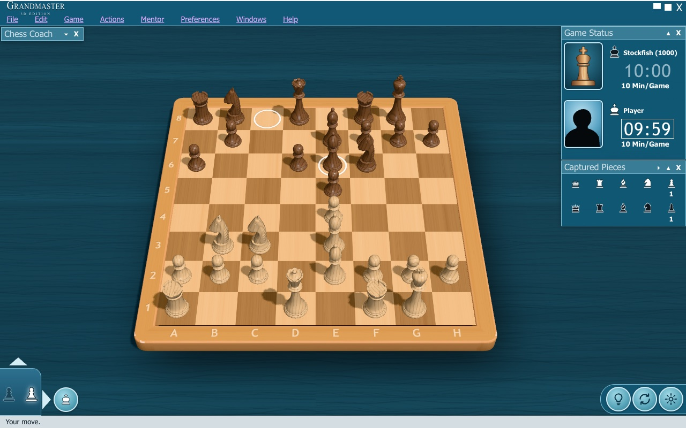
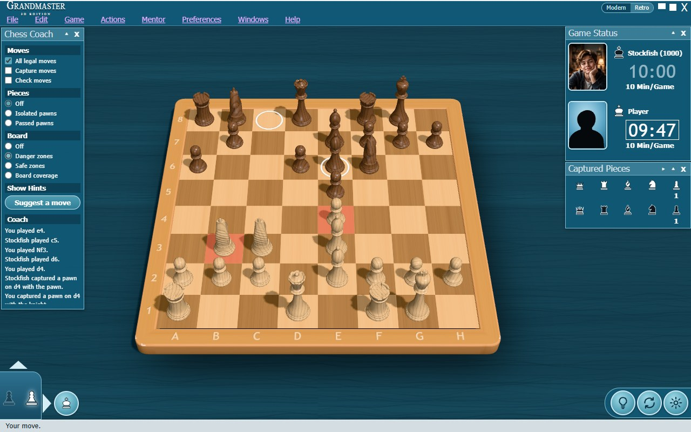
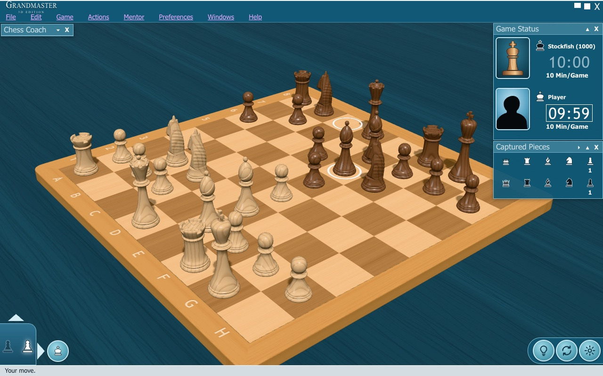
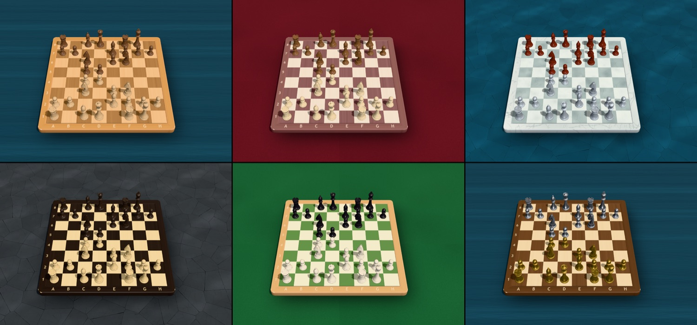

# Grandmaster 3D

A 3D chess game for the browser in the style of the classic early-2000s desktop chess games. It has
a wooden board on a blue cloth, Staunton pieces turned in Blender, teal panels, and Stockfish as
your opponent at six difficulty levels or any rating you choose.



## Features

- **A real 3D board.** Drag a corner of the board to rotate and tilt it, drag an edge to pan, and
  use the wheel or PgUp/PgDn to zoom. The arrow keys also rotate and tilt, as in the classic games.
  You can also right-drag anywhere, use two fingers on a touch screen, and press Home to reset.
  Actions → Top View (or T) looks straight down on the board.
- **Pieces modelled in Blender**, from profiles measured on reference screenshots. The knight is
  carved from a side silhouette into a horse head with ears, eyes, nostrils and a grooved mane. A
  shader gives the wood growth rings and grain, under a lacquer coat.
- **Stockfish 19** runs in a Web Worker at six levels (Beginner, Easy, Medium, Hard, Expert and
  Maximum Strength) or at a custom rating from 400 to 3000, chosen with a slider.
- **An opponent who looks the part**: the computer's portrait grows with its strength, from a boy
  at Beginner through old-master portraits of a teenager, a young man, a man of forty and an old
  man with a long white beard, to a brass automaton at Maximum Strength.
- **The full rules from chess.js**:
  - castling, en passant and promotion (with a choice of piece)
  - check, checkmate, stalemate and the draw rules (fifty moves, threefold repetition,
    insufficient material)
  - resignation and flag fall
- **Clocks** of 5, 10, 15 or 30 minutes per player, or untimed.
- **Undo and redo**, PGN and FEN import and export, a two-player mode, and flipping the board.
- **Chess Coach** board aids and commentary:
  - legal, capture and check moves
  - danger zones, safe zones and board coverage
  - isolated and passed pawns
  - hints from the engine
- **Optional animations**, both off by default:
  - *Follow move path*: pieces travel their real route. The knight goes two squares, turns and goes
    one more, lifting over pieces in its way.
  - *Demolish captures*: the captured piece shatters into fragments that were pre-fractured in
    Blender: wooden chunks, or glass shards with a glassy tinkle for glass pieces.
- **Looks you can change** under Preferences → Looks and Board and Pieces:
  - 4 one-click looks that set the board, pieces and table together
  - 7 boards, 8 piece sets in two carved shapes (Staunton and Bell), and 6 tables
  - a Custom choice for each, using your own colours
  - a glass look with a mirroring glass board and clear and black glass pieces. If glass runs
    below 40 frames a second, its reflections turn off by themselves (Preferences → Glass
    Reflections turns them back on).
- Sounds synthesised with Web Audio, so there are no audio files.

| Chess Coach and move list | Rotated and zoomed |
| --- | --- |
|  |  |

## Looks



| Category | Presets |
| --- | --- |
| Looks | Classic, Console Mahogany, Marble Edition, Glass Studio |
| Boards | Classic Maple, Mahogany, Marble, Walnut & Birch, Ebony & Boxwood, Tournament Green, Glass Board |
| Piece sets | Boxwood & Rosewood, Red Lacquer & Silver (Bell shape), Ebony & Boxwood, Walnut & Maple, Ivory & Onyx, Gold & Silver, Marble, Glass |
| Tables | Teal Cloth, Blue Stone, Slate, Green Felt, Burgundy, White Studio |

The Custom choices take your own colours:

| Custom | You pick |
| --- | --- |
| Board | Light squares, dark squares and frame, in wood, marble or a plain finish |
| Pieces | A colour for each side, in wood, lacquer, metal, stone, clear glass or polished glass |
| Table | One colour |

Changes show on the board straight away, even mid-game, and are remembered. Everything is painted
procedurally at runtime, so no texture files are needed.

## Getting started

You need Node.js 22 or later (24 LTS recommended).

```sh
npm install      # also copies the Stockfish engine into public/engine/
npm run dev      # http://localhost:5173
```

```sh
npm run build    # type-check and build into dist/
npm run preview  # serve the production build
```

## Tests

```sh
npm test               # unit and architecture tests (Vitest), including the real engine
npm run test:e2e       # end-to-end tests on the production build (Playwright, needs WebGL)
npm run ladder -- 8    # each difficulty plays the next one up, 8 games per pair
npm run lint && npm run format:check
```

For development and tests, the page accepts these URL parameters:

| Parameter | Effect |
| --- | --- |
| `fen=` | Start from a position |
| `anim=0` | Instant animations |
| `engine=off` | No engine |
| `difficulty=` | Difficulty level |
| `seed=` | Seed for the random generator |
| `debug=1` | Adds `window.__chessDebug` |

## Difficulty

Each level sets every Stockfish option, because options persist between searches:

| Level | Engine settings | Move choice |
| --- | --- | --- |
| Beginner | Skill Level 0, depth 2 | Picks among the top 5 lines, sometimes a blunder |
| Easy | Skill Level 1, depth 3 | Picks among the top 4 lines |
| Medium | UCI_Elo 1600 | Engine's move |
| Hard | UCI_Elo 1900 | Engine's move |
| Expert | UCI_Elo 2400 | Engine's move |
| Maximum Strength | Unrestricted, 64 MB hash | Engine's move |

A **Custom** rating is interpolated between these recipes. From 1320 up it uses UCI_Elo with the
think time of the nearest levels, so a custom 1600 plays exactly like Medium. Below 1320, where
Stockfish cannot limit itself, the skill, depth and move policy are interpolated through Beginner
and Easy, down to a looser 400.

The strength ladder (`npm run ladder -- 8`, run at half the think time) gave the stronger level of
each pair:

| Pair | Score |
| --- | --- |
| Easy vs Beginner | 6.5/8 |
| Medium vs Easy | 8/8 |
| Hard vs Medium | 6.5/8 |
| Expert vs Hard | 6.5/8 |
| Maximum vs Expert | 8/8 |

## Rebuilding the chess pieces

The pieces come from Python scripts that run in headless Blender (tested with Blender 5.2 LTS):

```sh
npm run models                 # build the set, export the GLBs, render previews
npm run models -- fragments    # re-fracture the pieces for Demolish captures
BLENDER=/path/to/blender npm run models
```

The modelling scripts live in [blender/scripts/](blender/scripts/):

| Script | What it does |
| --- | --- |
| `profiles.py` | The lathe profiles |
| `pieces.py` | The turned pieces |
| `knight.py` | The carved knight |
| `bell.py` | The Bell set: wide bell bases, thin stems and a double collar |
| `build_set.py` | Builds and checks both sets |
| `export_glb.py` | Exports the GLB files |
| `render_previews.py` | Renders the previews |
| `fracture.py` | Fractures the pieces into fragments |

The editable source is `blender/chess_set.blend`, previews are in [blender/renders/](blender/renders/),
and the exported models are in `public/models/chess/` (the Bell set in its `bell/` folder).

## Opponent portraits

Five portraits are public-domain old-master paintings and the sixth is an automaton rendered in
Blender. `npm run portraits` gives them all one crop, brushwork, varnish and canvas treatment.
Sources and licences are listed in [art/portraits/CREDITS.md](art/portraits/CREDITS.md).

## How it is built

```
src/game/     rules (ChessGame over chess.js), controller state machine, clock, settings, coach
src/engine/   UCI parsing, Stockfish adapter, Web Worker transport, difficulty presets, move policy
src/scene/    three.js scene, board, camera controls, piece loading and placement, highlights,
              input, move animations and paths, shatter effect
src/ui/       menu bar, panels, dialogs, icons
src/app/      wires everything together
blender/      modelling scripts, source .blend, renders
tests/        unit, architecture and end-to-end tests
```

chess.js is the authority: no move reaches the board unless it is legal, and engine moves are
checked like anyone else's. Every change of position bumps a generation number, and late engine
replies or interrupted animations are dropped. In development a consistency checker compares the 3D
board with the rules after every move.

## Deployment

The build is a static site with relative URLs, so it works on any static host, including from a
subpath. The included GitHub Actions workflow deploys it to GitHub Pages on every push to `main`
(once, set Settings → Pages → Source: GitHub Actions).

The engine is the single-threaded lite build of Stockfish (about 1.8 MB of WebAssembly). It needs no
special headers: no cross-origin isolation, no `SharedArrayBuffer`. The server only has to send
`.wasm` files as `application/wasm`, as GitHub Pages and most hosts do.

## Known limitations

- Strength labels such as "about 1600" are approximate. Medium and above use Stockfish's own
  UCI_Elo. Beginner and Easy add a move-picking policy on top of the lowest Skill Levels, because
  UCI_Elo stops at 1320.
- The lite engine uses a small neural network. It is far stronger than any human, but weaker than
  the full 94 MB build.
- Game review is limited to stepping back and forward through the moves; there is no annotation.
- End-to-end tests need a browser with WebGL, so CI runs only the unit tests.

## License

Grandmaster 3D is free software under the [GNU General Public License v3 or later](LICENSE). It
includes Stockfish, which is GPL-3.0. Third-party notices are in [NOTICE.md](NOTICE.md).

The look follows classic commercial chess games of the early 2000s. All models, textures, icons,
sounds and code here are original, and no assets from those games are used.
