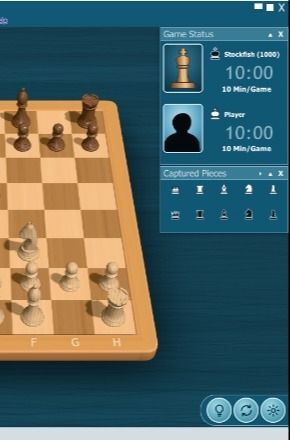

# Visual comparison

How close the game is to the main reference screenshot. That image is 587×440 and is kept locally
in `docs/reference/`; it is never published. We capture the game at 1024×768 in the same position
(`rnb1kb1r/ppp1pppp/8/3qn3/3P4/5N2/PPP1PPPP/R1BQKB1R w`), scale the capture to 587×440, and compare
the average colour of 7×7-pixel samples at fixed points (CIE76 ΔE; under about 5 is hard to tell
apart at this size).

## Geometry

The default camera is fitted to 13 hand-measured points (rank lines and playing-area corners) and
lands within **0.80 px rms** at 587×440 (`scripts/calibrate-camera.ts`). The board outline, frame
width and front-edge thickness agree with the reference within 2–4 px.

Piece heights were solved from the reference with the same camera. For flat-topped and round-topped
pieces the solve uses the far rim of the top, not its centre.

| Piece | Height (squares) |
| --- | --- |
| King | 1.745 |
| Queen | 1.63 |
| Bishop | 1.36 |
| Knight | 1.30 |
| Rook | 0.93 |
| Pawn | 0.83 |

## Colour, round 1

Only our side is published; the reference stays in `docs/reference/`.

| Region | Ours | Reference | ΔE |
| --- | --- | --- | --- |
| cloth_left | `#123e4f` | `#174255` | 2.2 |
| cloth_bottom | `#124151` | `#154559` | 3.2 |
| cloth_under_board | `#0a252f` | `#0e2f3d` | 5.4 |
| frame_left | `#e19f57` | `#e3a25d` | 2.1 |
| frame_front | `#de9e55` | `#e1a15e` | 3.3 |
| face_top | `#c98d54` | `#dc9d5f` | 6.5 |
| face_mid | `#9e6b39` | `#9e7245` | 5.5 |
| face_low | `#7d5932` | `#6d502e` | 6.2 |
| light_d4 | `#f3be84` | `#f4c48d` | 3.5 |
| light_f6 | `#f4c087` | `#f5c38f` | 3.1 |
| dark_e4 | `#b37d44` | `#b8824a` | 2.0 |
| dark_c4 | `#b37d44` | `#b7824b` | 2.4 |
| w_pawn_b2 | `#e2b989` | `#eac08e` | 2.7 |
| w_king_e1 | `#c5a174` | `#bc9670` | 5.2 |
| w_queen_d1 | `#cfa97b` | `#d4a97b` | 2.2 |
| b_king_e8 | `#6d4523` | `#6b462c` | 5.3 |
| b_queen_d5 | `#734a2a` | `#744f32` | 3.7 |
| b_pawn_c7 | `#835939` | `#835a41` | 4.2 |

**Mean ΔE 3.8** across the cloth, the board shadow, the frame top and front edge, light and dark
squares, and both piece sets.

## Changes made while tuning

The tuning rounds made these changes:

- Square, frame and cloth base colours.
- The light balance: a stronger key light, less fill, and a weak front light so that shadows read
  as in the reference.
- A soft contact shadow under the board.
- A frame front edge 0.45 squares thick, with a rounded top bevel and darker shading toward the
  cloth.
- Piece widths narrowed to the measured bases.
- The rook height corrected to 0.93.
- The wood colours: boxwood for White and a desaturated rosewood for Black.

## Marble Edition

Compared with the marble-board reference from a camera fitted to it (2.8 px rms), over 22 sample
points on the squares, frame, pieces and table:

| Round | Mean ΔE | What changed |
| --- | --- | --- |
| 1 | 7.3 | Cooler marble, a 0.2-square board, larger coordinates, darker silver and red |
| 2 | 5.7 | The Bell piece set, polished mottled pieces that mirror the board, and light slab veins in place of dark per-square veins |

The squares now measure ΔE 0 to 5. The largest remaining gaps are on the red pieces, where the
reference puts its pinkish highlights elsewhere (ΔE up to 24 at single points), and on the shaded
left side of the frame (ΔE 8). The default look still measures 3.7 against the main reference.
