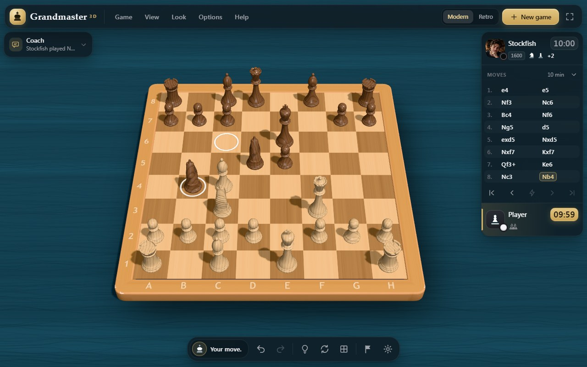
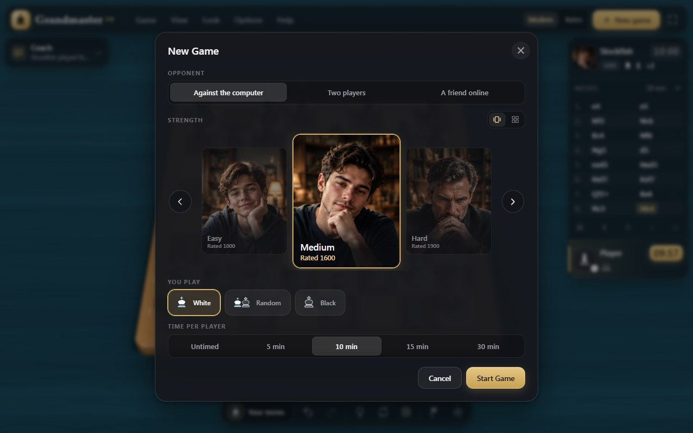
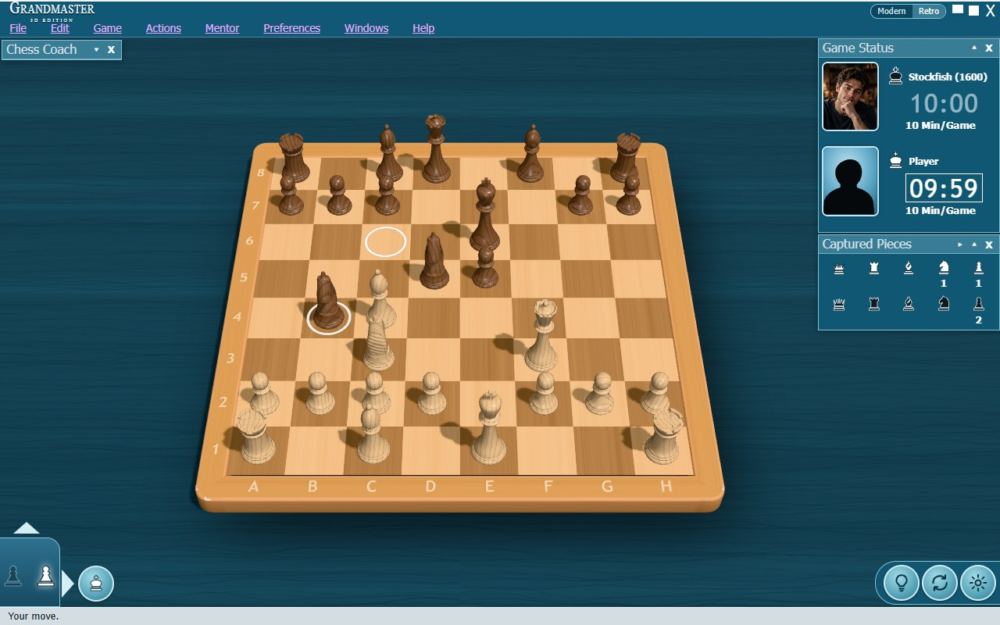

# Grandmaster 3D user guide

How to play, what every menu, card, button and setting does, in both interfaces.

- [The two interfaces](#the-two-interfaces)
- [Starting a game](#starting-a-game)
- [Playing a friend online](#playing-a-friend-online)
- [Moving pieces](#moving-pieces)
- [Looking around the board](#looking-around-the-board)
- [The modern interface](#the-modern-interface)
- [The retro interface](#the-retro-interface)
- [Menus](#menus)
- [The Chess Coach](#the-chess-coach)
- [Clocks, results and resigning](#clocks-results-and-resigning)
- [Saving and loading games](#saving-and-loading-games)
- [Looks](#looks)
- [Settings](#settings)
- [Keyboard and mouse](#keyboard-and-mouse)
- [What is remembered](#what-is-remembered)
- [Troubleshooting](#troubleshooting)

## The two interfaces

The 3D board is the same in both interfaces. They differ in everything around it:

| | Modern | Retro |
| --- | --- | --- |
| Look | Floating dark-glass cards with a gold accent | Teal panels and a title bar in the style of a 2000s desktop chess game |
| Top bar | Wordmark, five menus, Modern / Retro switch, New game, full screen | Wordmark, eight menus, Modern / Retro switch, window buttons |
| Players and moves | One Match card: portraits, clocks, captured pieces, material lead, move list | Game Status and Captured Pieces windows |
| Coach | Coach card, top left | Chess Coach window, top left |
| Game buttons | Dock at the bottom centre, with the status line | Turn tab and round buttons at the bottom, status line along the edge |
| New Game | A sheet with a portrait card per opponent | A dialog with drop-down lists |

**Switching.** Use the **Modern | Retro** switch in the top bar, or the menu: Look ▸ Interface in
Modern, Preferences ▸ Interface in Retro. The switch happens at once. The game, the clocks, the
coach's remarks and the board aids carry over, and the choice is remembered. New players start in
Modern.

## Starting a game

Open **New game** with the gold button in the top bar (Modern), the round king button at the
bottom left (Retro), Game or File ▸ New Game…, or Ctrl+N.

- **Opponent.** Play against the computer (Stockfish), two players on one device, or a friend
  online (see [Playing a friend online](#playing-a-friend-online)).
- **Strength.** Six levels, each with its own opponent's portrait:

  | Level | About | Portrait |
  | --- | --- | --- |
  | Beginner | 600 | a smiling boy |
  | Easy | 1000 | a teenager |
  | Medium | 1600 | a young man |
  | Hard | 1900 | a man in his forties |
  | Expert | 2400 | a white-bearded wizard |
  | Maximum Strength | 3000 | a robot |

  **Custom** lets you pick any rating from 400 to 3000 with a slider, which also says which level
  it is close to. A custom opponent shows the portrait of the nearest level.
- **You play.** White, Black or Random. When you play Black, the board turns round and the
  computer moves first.
- **Time.** Untimed, or 5, 10, 15 or 30 minutes per player.

In Modern, every choice is on one page. Click a card or chip, or use the arrow keys inside a group.
The opponents show as a **slider** of big portraits: the chosen one in the middle, its neighbours
smaller on either side. The ‹ › arrows, a click on a neighbour, a swipe or the arrow keys bring the
next one to the middle, and it goes round without end. The two icons by **Strength** switch to a
**compact** grid of all the opponents at once, and back; the game remembers which you prefer.
Shortcuts from the menus start a new game straight away with one thing changed: Play as White,
Play as Black, Two Players and Time Control. Changing the Difficulty does not start a new game; the
computer plays at the new strength from its next move.

## Playing a friend online

Online play is **for adults only**. It connects your computer directly to the other player's, with
no server in between, so **the other player will be able to find your IP address** (your
approximate location and internet provider). Share game links only with people you know and trust.

**Inviting a friend.** Open **New game**, choose **A friend online**, pick your side and the time,
and press **Create Link**. (Game ▸ Play a Friend Online opens the same choices.) Read the warning,
type the name your friend will see, tick **I am 18 or older and understand that my IP address will
be visible to the other player**, and press **Create Link**. Copy the link and send it to your
friend, or let them scan the QR code below it with their phone's camera: it opens the same link.
Every new game gets its own link and its own code. The window closes by itself when they arrive. Cancel stops waiting.

**Joining.** Open the link you were sent. The same warning comes first, with its checkbox unticked;
tick it and press **Join Game**. You play the side your friend did not choose. Nothing connects
until you have agreed, and the link disappears from the address bar as soon as the page opens.

**During the game.**

- The cards show both names. The status line says whose move it is, and whether your friend's
  connection dropped. A dropped game carries on by itself when they come back.
- Take back, replay and hints are off. Each side's clock runs on its own turn, starting with the
  first move.
- **Video and voice.** Your card has a microphone and a camera switch; both start off, and the
  browser asks for permission the first time you turn one on. Your own picture shows mirrored on
  your card. Turning a switch off stops the device (the camera light goes out). Your friend's
  picture and sound appear on their card when they turn theirs on; the speaker switch there mutes
  them for you only, and a crossed-out microphone shows when no sound comes from them. In Modern a
  card with video opens up to show it; in Retro it fills the portrait frame.
- **Offer Draw** (Game menu) offers a draw; the game is drawn when both of you agree.
- **Resign**, or **Leave Online Game**, ends the game as a loss. Starting any other game asks first,
  since it means leaving.
- If your friend is gone for two minutes in an untimed game, you can **Claim the Win**. In a timed
  game, their clock keeps running.
- After the game, **Rematch** swaps the colours once you both ask (the warning comes again).
- If you reload the page, the game offers to rejoin, after the warning.

**If the other app cheats.** Your game checks everything it receives. An impossible move or broken
game data ends the game in your favour and disconnects the other player.

**If it cannot connect.** Some networks, such as mobile data or office Wi-Fi, block direct
connections between two computers. Try another network, or ask your friend to. Your link keeps
working after a failed attempt, so your friend can simply open it again. If you made the link on a
phone, come back to the game after sending it: phones pause pages in the background. The clock on
either device does not matter, even if it is set by hand or wrong by hours.

## Moving pieces

- **Click** a piece, then the square to move it to. Possible moves show as dots (captures as rings)
  when Show Legal Moves is on.
- **Drag** a piece and drop it on its square. An illegal drop puts the piece back.
- **Keyboard:** Shift+arrow keys move a square cursor, Enter picks up and puts down, Esc cancels.
- **Touch:** tap a piece, then tap its square.
- **Promotion:** a pawn reaching the last rank asks for a queen, rook, bishop or knight. Click one,
  or press Q, R, B or N.

Castling and en passant are made like any other move: move the king two squares to castle.

## Looking around the board

| To | With the mouse | With the keyboard |
| --- | --- | --- |
| Rotate and tilt | Drag a corner of the board, or right-drag anywhere | ← → rotate, ↑ ↓ tilt |
| Pan | Drag an edge of the board | |
| Zoom | Mouse wheel | PgUp / PgDn |
| Look straight down | Top view button (Modern dock) | T |
| Turn to the other side | Flip button | F |
| Go back to the start view | | Home |

On a touch screen, twist two fingers to rotate (the board turns with your fingers; Settings ▸
Reverse two-finger rotation turns it the other way), pinch to zoom and drag two fingers to pan.

## The modern interface

**Top bar.** The wordmark, then the **Game, View, Look, Options and Help** menus. On the right are
the **Modern | Retro** switch, the gold **New game** button and **Full screen**. On a phone, Full
screen moves to View ▸ Full Screen.

**Coach card** (top left). Folded, it shows the coach's latest remark. Click it to open the board
aids, Suggest a move and the commentary; see [The Chess Coach](#the-chess-coach).

**Match card** (top right). The opponent is at the top and you are at the bottom, the same way
round as the board.

- Each row has a portrait, a white or black disc for the player's colour, the rating, the pieces
  they have taken (grouped by kind, strongest first) and their material lead, such as **+2**.
- The side to move has a gold edge. Its running clock turns gold, and red in the last 30 seconds
  of a timed game.
- While the computer thinks, its row says **Thinking** with the engine's current evaluation.
- The move list between the rows marks the latest move. Its buttons take back all moves, take
  back one, make the computer move now, replay one and replay all. The chevron folds the list
  away.

**Dock** (bottom centre). On the left, the side to move and the status line: "Your move.",
"Check!", "Stockfish is thinking…" or the result. Then the buttons:

| Button | Does |
| --- | --- |
| ↶ Take back | Undo your last move (against the computer, its reply as well). Ctrl+Z |
| ↷ Replay | Redo a move that was taken back. Ctrl+Y |
| Light bulb | Hint: the coach suggests a move. H |
| Circular arrows | Flip the board. F |
| Grid | Top view, lit while it is on. T |
| Flag | Resign, after asking |
| Sun | Settings |

All dialogs in Modern are frosted sheets: the main choice is gold and on the right, and Escape or
the round × closes them.

| New Game sheet | Coach card with danger zones |
| --- | --- |
|  |  |

## The retro interface

**Title bar.** The wordmark and the eight menus: **File, Edit, Game, Actions, Mentor, Preferences,
Windows and Help**, with an underlined letter for Alt+letter. On the right are the **Modern | Retro**
switch and three window buttons:

| Button | Does |
| --- | --- |
| ▬ | Collapse all windows to their title bars, or expand them again |
| ▢ | Full screen |
| X | Hide all windows, or show them again |

**Chess Coach** (top left) starts folded to its title bar; ▾ opens it. Each window's ▴ folds it and
its X closes it; the Windows menu brings it back.

**Game Status** (top right). A card for each player with a portrait, a king in their colour, the
name and rating, a large clock (the running one is boxed in white) and the time control. The move
list is hidden at first. The ▲ above the turn tab, or Windows ▸ Move List, shows it with
⏮ ◀ ■ ▶ ⏭ buttons.

**Captured Pieces.** One row per side counts the queens, rooks, bishops, knights and pawns taken.
The ▸ in its title shows the material balance.

**Bottom left.** The turn tab lights the pawn of the side to move. The round king button starts a
**New game**, and the ▶ slides out **Take back**, **Replay** and **Resign**.

**Bottom right.** Round buttons for **Hint**, **Flip board** and **Settings**.

**Status line.** One line along the bottom edge about the game.

## Menus

Both interfaces offer the same commands; only the grouping differs. Ticks show options that are on.

### Modern

| Menu | Entries |
| --- | --- |
| **Game** | New Game… (Ctrl+N) · Open Game or Position… · Save Game (PGN) · Copy FEN · Copy PGN · Play as White · Play as Black · Two Players · Difficulty ▸ · Time Control ▸ · Undo Move (Ctrl+Z) · Redo Move (Ctrl+Y) · Move Now (M) · Suggest a Move (H) · Resign |
| **View** | Flip Board (F) · Top View (T) · Reset View (Home) · Board Coordinates · Show Legal Moves · Show Last Move · Coach · Match Card · Move List · Full Screen |
| **Look** | Looks ▸ · Board and Pieces… · Board ▸ · Piece Set ▸ · Table ▸ · Interface ▸ Modern / Retro |
| **Options** | Sound · Animation Speed ▸ · Follow Move Path · Demolish Captures · Glass Reflections · Settings… |
| **Help** | Keyboard and Mouse… · About Grandmaster 3D… |

### Retro

| Menu | Entries |
| --- | --- |
| **File** | New Game… (Ctrl+N) · Open Game or Position… · Save Game (PGN) · Copy FEN · Copy PGN |
| **Edit** | Undo Move (Ctrl+Z) · Redo Move (Ctrl+Y) · Paste Game or Position… · Export… |
| **Game** | Play as White · Play as Black · Two Players · Difficulty ▸ · Time Control ▸ · Resign |
| **Actions** | Hint (H) · Move Now (M) · Take Back (Ctrl+Z) · Flip Board (F) · Top View (T) · Reset View (Home) |
| **Mentor** | Show Legal Moves · Show Last Move · Chess Coach · Suggest a Move (H) |
| **Preferences** | Sound · Animation Speed ▸ · Follow Move Path · Demolish Captures · Glass Reflections · Board Coordinates · Looks ▸ · Board and Pieces… · Board ▸ · Piece Set ▸ · Table ▸ · Interface ▸ Modern / Retro · Settings… |
| **Windows** | Chess Coach · Game Status · Captured Pieces · Move List · Full Screen |
| **Help** | Keyboard and Mouse… · About Grandmaster 3D… |

### What the entries do

| Entry | Does |
| --- | --- |
| New Game… | Opens the New Game sheet (Modern) or dialog (Retro) |
| Open Game or Position…, Paste Game or Position… | Opens Game and Position, ready to paste a PGN game or a FEN position |
| Save Game (PGN) | Downloads the game as `game.pgn` |
| Copy FEN, Copy PGN | Copies the position or the game to the clipboard |
| Export… | Opens Game and Position with the game's PGN filled in |
| Play as White, Play as Black, Two Players | Starts a new game on that side, or for two players |
| Difficulty ▸ | Sets the computer's level, or Custom… for a rating chosen with a slider |
| Time Control ▸ | Starts a new game that is untimed or 5, 10, 15 or 30 minutes per player |
| Undo Move, Take Back, Redo Move | Takes back or replays a move (a move pair against the computer) |
| Move Now | Makes the computer play the best move it has found so far |
| Hint, Suggest a Move | Rings the suggested move's squares in green and names it in the coach |
| Resign | Gives up the game: you, or in a two-player game the side to move |
| Flip Board, Top View, Reset View | Turns the board round, looks straight down, goes back to the start view |
| Board Coordinates | Shows the letters and numbers around the board |
| Show Legal Moves | Shows dots where the picked-up piece can go |
| Show Last Move | Rings the last move's two squares in white |
| Coach, Match Card, Move List / Chess Coach, Game Status, Captured Pieces, Move List | Shows or hides that card or window |
| Looks ▸, Board ▸, Piece Set ▸, Table ▸, Board and Pieces… | See [Looks](#looks) |
| Interface ▸ | Switches between the modern and the retro interface |
| Sound, Animation Speed ▸, Follow Move Path, Demolish Captures, Glass Reflections, Settings… | See [Settings](#settings) |
| Full Screen | Fills the screen with the game; press Esc to leave |
| Keyboard and Mouse… | Lists the controls |
| About Grandmaster 3D… | Version, license and the open-source projects it is built on |

Menus work from the keyboard too. Alt plus the menu's letter opens it (Alt+G for Game, Alt+V for
View), the arrow keys move through entries and submenus, Enter chooses and Esc closes. While a menu
is open, the board's one-key shortcuts (H, M, F, T) are held back.

## The Chess Coach

The coach is the Coach card in Modern and the Chess Coach window in Retro. Both have the same aids,
seen from your side; in a two-player game, from the side to move.

| Aid | Shows |
| --- | --- |
| All legal moves | Dots on the squares the picked-up piece can reach. This is the same option as Show Legal Moves |
| Capture moves | Orange rings on every square where you can capture now (on your turn) |
| Check moves | Orange rings on every square where a move gives check (on your turn) |
| Pawns: Isolated | Yellow rings on your pawns with no friendly pawn on either neighbouring file |
| Pawns: Passed | Yellow rings on your pawns with no enemy pawn ahead on their own or a neighbouring file |
| Board: Danger | Your pieces that the opponent attacks, tinted red |
| Board: Safe | Squares the opponent does not attack and does not occupy, tinted green |
| Board: Coverage | Every square you attack, tinted blue |

**Suggest a move** asks the engine for a quick move and rings its from- and to-square in green.
H does the same. **Commentary** describes every move ("You played e4.", "Stockfish captured a
knight on f3 with the bishop.") and the result. In Modern the latest remark is in gold and also
shows on the folded card.

## Clocks, results and resigning

Each side's clock runs only on its own turn. Untimed games show the time each side has used
instead. A game ends by:

- **Checkmate** or **stalemate**;
- **a draw:** fifty moves without a capture or pawn move, threefold repetition, or too little
  material to mate;
- **running out of time** (flag fall);
- **resigning.** Modern asks in its own dialog, where Cancel has the focus, so a stray Enter keeps
  playing. Retro asks with the browser's confirm box.

The **Game Over** dialog then offers **New Game**, **Review the Board** (close it and look around,
or step through the moves) and **Save Game (PGN)**.

## Saving and loading games

**Game and Position** (File or Game ▸ Open Game or Position…) shows the current position as FEN and
has a box for a game or position:

- paste a PGN game or a FEN position and press **Load**, or press **Open File…** to read a `.pgn`,
  `.fen` or `.txt` file;
- **Copy** copies the box, and **Save PGN** downloads the current game.

A loaded game can be stepped through with take back and replay.

## Looks

**Looks ▸** sets the board, pieces and table together:

| Look | Board | Pieces | Table |
| --- | --- | --- | --- |
| Classic | Classic Maple | Boxwood & Rosewood | Teal Cloth |
| Console Mahogany | Mahogany | Boxwood & Rosewood | Blue Stone |
| Marble Edition | Marble | Red Lacquer & Silver (Bell shape) | Blue Stone |
| Glass Studio | Glass Board | Glass | White Studio |

**Board and Pieces…** shows every look, board, piece set and table as a swatch. The Board, Pieces
and Table tabs each end with **Custom colours**:

- the board's light squares, dark squares and frame, in wood, marble or plain;
- each side's pieces, in wood, lacquer, metal, stone, clear glass or polished glass;
- the table colour.

Every choice shows on the board at once. **OK** keeps it and **Cancel** or Escape puts back what
was there before.

## Settings

The **Settings** dialog (sun button, Options or Preferences ▸ Settings…) collects the options:

| Section | Option | Does |
| --- | --- | --- |
| Animation | Speed | Instant, Fast, Normal or Slow piece moves |
| | Follow move path | Pieces travel their real route: the knight goes two squares, turns and lifts over pieces in its way |
| | Demolish captures | A captured piece shatters into wooden chunks, or glass shards with a tinkle for glass pieces |
| Board | Show legal moves, Show last move, Show board coordinates | As in the menus |
| | Glass reflections | Real mirroring and see-through glass; off uses cheaper look-alikes |
| | Board, pieces and table colours… | Opens Board and Pieces |
| Touch | Reverse two-finger rotation | A two-finger twist turns the board against your fingers instead of with them |
| Sound | Sound effects | Sounds for moves, castling, captures, promotion, check, an illegal move, shattering pieces and the end of the game |

## Keyboard and mouse

| Keys | Does |
| --- | --- |
| Ctrl+N | New game |
| Ctrl+Z / Ctrl+Y (or Ctrl+Shift+Z) | Take back / replay |
| H | Hint |
| M | Make the computer move now |
| F | Flip the board |
| T | Top view on and off |
| Home | Reset the view |
| ← → / ↑ ↓ | Rotate / tilt the board |
| PgUp / PgDn, mouse wheel | Zoom |
| Shift+arrows, Enter | Move with the keyboard |
| Esc | Cancel the selection, close a menu or dialog |
| Alt+letter | Open a menu |
| Q R B N | Choose the promotion piece |

On macOS, Cmd works in place of Ctrl.

## What is remembered

The browser keeps your preferences for the next visit:

- the interface (Modern or Retro), and whether New Game shows the opponents as a slider or a grid;
- the side, opponent, difficulty, custom rating and time control;
- sound, animation speed, move path, demolish and glass reflections;
- the direction of the two-finger rotation;
- legal-move, last-move and coordinate marks;
- the looks and your custom colours.

The game itself is not kept: a reload starts a new game. An online game is the exception: the tab
keeps it until it closes, so a reload can rejoin (after the warning). The name you last used online
is offered again; agreeing to the warning never is. The coach aids and which cards or windows
are open last for the visit. In a private window, or when the browser blocks storage, the game uses
the defaults and nothing is saved.

## Troubleshooting

- **Glass looks are slow.** If a glass look animates below 40 frames a second, the game turns Glass
  Reflections off by itself and says so in the coach. You can turn it back on in Options or
  Preferences.
- **The engine had a problem.** Stockfish restarts by itself; the coach mentions it.
- **The camera or microphone is blocked.** The coach says so. Allow it in the browser's site
  settings (the icon next to the address), then turn the switch on again.
- **An online game cannot connect.** Some networks block direct connections between two players.
  Try another network. The link only works while the player who made it keeps the game open.
- **The board is covered on a small screen.** Fold the Match card's move list or the Coach card, or
  hide them from the View (Modern) or Windows (Retro) menu.
